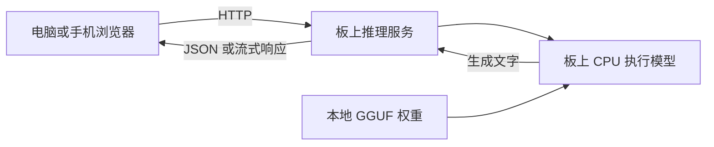

# 后续计划：板上小模型与聊天网站

本阶段先学习驱动，AI 应用在后续开展。目标是在鲁班猫本地生成文字，并搭建推理接口和个人聊天网页。

## 前期候选方案

| 部分 | 候选方案 | 实验时需要确认 |
| --- | --- | --- |
| 硬件 | LubanCat-1N，RK3566，暂按 2GB 内存 | 实际可用内存、存储和散热 |
| 系统 | 驱动学习阶段验收的板上系统 | ARM64 用户空间、动态库与运行时兼容性 |
| 模型 | Qwen2.5-0.5B-Instruct-GGUF，Q4_K_M | 来源、版本、校验值、回复质量与运行内存 |
| 推理引擎 | llama.cpp 的 CPU 推理 | 固定通过验证的版本与构建参数 |
| HTTP 服务 | llama-server | 健康检查、聊天接口、超时和资源限制 |
| 网页 | 先验证内置网页，再编写个人聊天页 | 提问、等待、回复和错误状态 |
| 服务管理 | systemd | 普通用户运行、启动、停止和日志 |

前期查阅的 Qwen 官方 Q4_K_M 权重文件约 491MB；文件大小与运行内存分别测量。此前讨论的 Debian 12 / 6.1 镜像属于另一个系统候选，当前源码学习基线仍为 -24。

## 请求链路

服务通过 Linux 的文件、内存和网络能力工作，可与前面的进程管理、资源测量和服务管理知识联系起来。

## 最小实验范围

起步时使用一个常驻模型、单路生成、512 tokens 上下文和 64～128 tokens 的短回复，比较 2 和 4 个 CPU 线程的表现。这些是待测试参数。

先记录生成速度、首次响应时间、内存和温度，再决定是否继续服务化。前期 RKLLM 平台名单调查未列出 RK3566，因此候选路线为 CPU 推理；实施时重新核对支持情况。

## 验收顺序

1. 板上生成一句可读的简短回复，保存参数与资源测量结果。
2. HTTP 健康检查与聊天接口可用。
3. 浏览器显示真实模型回复及错误状态。
4. 连续完成 10 次短请求，观察内存、温度和系统日志。
5. 配置服务后，验证重启恢复与日志查询。

该方案尚未进行板上推理或性能验证。原始调查及资料链接保存在[前期 AI 方案](archive/02-local-chat.md)。
