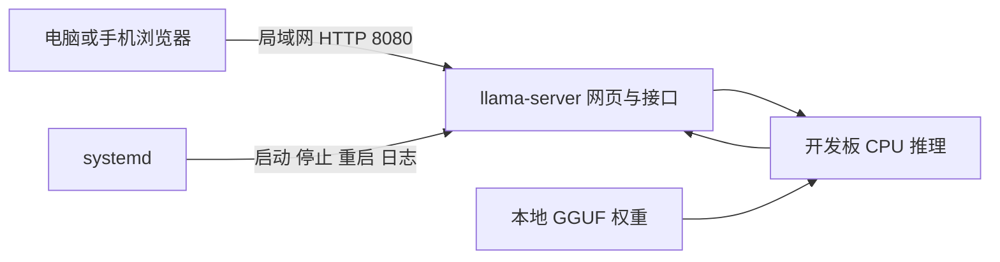

# 鲁班猫本地 AI、知识库、DDNS 与开机自启技术方案

更新日期：2026-11-15。本文记录实际环境、复现命令与后续部署方案。公网域名限定为 DuckDNS、Dynu，不采用 Tailscale 或 Cloudflare 接入。按“理解原理 → 少量操作 → 检查结果”逐步实施。

## 1. 当前完成情况

已完成：

- 建立个人内核仓库，固定官方源码起点 `rk356x-4.19.232-24`。
- 实测板上系统和内存，在板上原生编译 llama.cpp `b5046`。
- 下载并校验 Qwen2.5-0.5B-Instruct Q4_K_M 权重。
- 执行 2/4 线程 CPU 短推理，打开局域网聊天网页。
- 申请 DuckDNS 域名 `orbits-yiyi.duckdns.org`。Dynu 的具体主机名尚未提供，以下使用占位符。

本次准备了文档、启动脚本、安装器和 systemd 单元；尚未替用户安装到开发板、启用服务或重启验收。此前在终端手动启动的进程没有配置开机自启。

待完成：完整回答质量评估、内存/温度/长期运行测量、服务自启验收、公网连通、HTTPS 与认证、文档检索及引用。现在的网页是本地聊天实验，尚未实现知识库 RAG。

## 2. 实测环境与源码关系

| 项目 | 已确认值 |
| --- | --- |
| 开发板 | LubanCat-1N，按当前板型记录为 RK3566 |
| 内存 | 标称 4GB，`free -h` 显示 3.8GiB；首次采样 available 2.6GiB |
| Swap | 首次采样 0B |
| 用户空间 | `aarch64`，Ubuntu 20.04.6 LTS / Focal |
| 镜像构建标识 | `Sat Apr 18 14:55:41 CST 2026` |
| 根分区 | `/dev/mmcblk0p3`，29G，剩余约 25G |
| 板上用户与项目路径 | `cat`，`/home/cat/workspace/ai/llama.cpp` |
| 板上局域网 IP | 此前为 `192.168.10.211`，当次以 `hostname -I` 为准 |
| 电脑 IP / 网关 | 此前为 `192.168.10.44` / `192.168.10.1` |
| 编译工具 | CMake 3.16.3，GCC / G++ 9.4.0 |
| 推理引擎 | llama.cpp `b5046`，提交 `74d4f5b041ad837153b0e90fc864b8290e01d8d5` |

`/dev/mmcblk0p3` 本身不足以区分 eMMC 和 TF 卡，本文不据此断言启动介质。实际运行内核版本还需执行 `uname -r`；源码标签不能代替运行内核版本，也不能据此认定 -24 已构建并烧录。

开发机是 WSL2 / Ubuntu 24.04 / x86_64。以下编译、推理和 systemd 命令在开发板执行，文件传输命令另行标明。

Linux 与驱动学习仍沿用[项目方案](01-project-plan.md)、[驱动路线](03-driver-roadmap.md)、[启动与 eMMC](04-boot-and-emmc.md)、[源码迁移](05-source-migration.md)。这里构建的是用户态 AI 程序。

## 3. 本地应用架构



GGUF 是引擎读取的模型格式，Q4_K_M 是量化规格，用于减少权重存储与资源需求。491MB 文件大小不等于进程总内存。`llama-cli` 用于终端实验，`llama-server` 提供网页和 HTTP 接口。

对应的 Linux 学习点包括文件权限、进程、内存、网络监听、信号和服务日志。当前验收使用 CPU，不声称已启用 NPU/GPU 加速。

## 4. 从源码复现

现有开发板已完成本节；保留命令用于以后重建，无需重复操作。

### 4.1 工具与版本

```bash
sudo apt update
sudo apt install -y build-essential cmake git curl ca-certificates libssl-dev pkg-config
mkdir -p ~/workspace/ai
cd ~/workspace/ai
git clone --depth 1 --branch b5046 https://github.com/ggml-org/llama.cpp.git
cd llama.cpp
git describe --tags --exact-match
git rev-parse --short=12 HEAD
```

预期输出 `b5046` 和 `74d4f5b041ad`。标签检出的 detached HEAD 正常。浅克隆只取得一层历史，因此二进制显示 `version: 1 (74d4f5b)`，核对时以提交号和标签为依据。

`b5046` 是本地实验的固定点，不代表上游 LTS 或已完成公网安全验收。

### 4.2 配置与编译

```bash
cmake -S . -B build \
  -DCMAKE_BUILD_TYPE=Release \
  -DGGML_NATIVE=OFF \
  -DGGML_CPU_ARM_ARCH=armv8-a \
  -DLLAMA_BUILD_TESTS=OFF \
  -DLLAMA_CURL=OFF
cmake --build build --target llama-cli llama-server -j 2
./build/bin/llama-cli --version
./build/bin/llama-server --version
```

`-j 2` 控制编译任务并发，运行时的 `-t 4` 控制推理线程。ARMv8-A 基础指令集是已经跑通的构建基线；后续优化可以另建构建目录测量。

### 4.3 模型与校验

| 项目 | 固定值 |
| --- | --- |
| 官方仓库 | `Qwen/Qwen2.5-0.5B-Instruct-GGUF` |
| 仓库修订 | `9217f5db79a29953eb74d5343926648285ec7e67` |
| 文件 | `qwen2.5-0.5b-instruct-q4_k_m.gguf` |
| 文件大小 | 491400032 字节 |
| SHA256 | `74a4da8c9fdbcd15bd1f6d01d621410d31c6fc00986f5eb687824e7b93d7a9db` |

官方站直连曾出现 TLS 连接重置。实际通过第三方 HF-Mirror 下载，并已通过官方 SHA256 校验：

```bash
cd ~/workspace/ai/llama.cpp
mkdir -p models
curl -fL -C - --connect-timeout 20 --retry 2 \
  -o models/qwen2.5-0.5b-instruct-q4_k_m.gguf \
  "https://hf-mirror.com/Qwen/Qwen2.5-0.5B-Instruct-GGUF/resolve/9217f5db79a29953eb74d5343926648285ec7e67/qwen2.5-0.5b-instruct-q4_k_m.gguf"
echo "74a4da8c9fdbcd15bd1f6d01d621410d31c6fc00986f5eb687824e7b93d7a9db  models/qwen2.5-0.5b-instruct-q4_k_m.gguf" | sha256sum -c -
```

使用官方源时，只将 URL 域名换成 `huggingface.co`，其余路径及校验保持一致。模型权重和构建产物不提交到内核仓库。

## 5. 终端推理与实测数据

```bash
cd ~/workspace/ai/llama.cpp
./build/bin/llama-cli \
  -m models/qwen2.5-0.5b-instruct-q4_k_m.gguf \
  -t 4 -c 512 -n 128 -cnv --single-turn \
  -sys "你是一个中文助手，请简洁准确地回答问题。" \
  -p "请用两句话解释 Linux 内核的作用。"
```

| 指标 | 2 线程 | 4 线程 |
| --- | ---: | ---: |
| 加载耗时 | 2629.04ms | 2064.43ms |
| 处理输入，均为 35 tokens | 7697.47ms | 4454.75ms |
| 输入处理速度 | 4.55 tokens/s | 7.86 tokens/s |
| 生成阶段计数 | 15 runs | 19 runs |
| 生成阶段耗时 | 4801.54ms | 3903.06ms |
| 生成速度 | 3.12 tokens/s | 4.87 tokens/s |
| 引擎报告总耗时 | 12690.90ms | 8501.42ms |

本次短实验生成速度提高约 56%，服务暂用 4 线程。两次输出长度不同，缓存、温度等未控制，不能当作严格基准，也不能把加载耗时的变化全部归因于线程数。

`sampling time` 只统计采样开销，生成速度看 `eval time`。token 与汉字或单词并非一一对应。日志证明推理完成，但未保留完整回复用于质量验收。

## 6. 已跑通的局域网服务

```bash
cd ~/workspace/ai/llama.cpp
./build/bin/llama-server \
  -m models/qwen2.5-0.5b-instruct-q4_k_m.gguf \
  -t 4 -c 1024 -n 128 -np 1 \
  --host 0.0.0.0 --port 8080
```

同一局域网浏览器访问 `http://192.168.10.211:8080`；IP 变化时以 `hostname -I` 为准。`0.0.0.0` 是监听设置，浏览器使用板子的实际地址。`-np 1` 表示一次生成一条回复；1024 tokens 用于短对话。

另开板上终端检查：

```bash
curl --fail --max-time 10 http://127.0.0.1:8080/health
ss -lntp 'sport = :8080'
```

加载中可能返回 503，加载后健康接口应成功。网页可打开、接口健康、回答正确，分别验收不同环节。前台进程按 Ctrl+C 会停止，SSH 会话结束也可能导致终止；持续运行交由 systemd 管理。

### 6.1 回复没有结束就停止

后续网页截图显示代码在 `typedef struct` 中途结束。上面的 `-n 128` 是短问答实验的上限，不足以承载较长代码。b5046 服务端会执行生成预算，网页请求更多 tokens 也不能绕过服务端的有限上限；网页若指定了更小上限，同样会提前停止。

启动脚本和新参数模板已调整为 `AI_CONTEXT=4096`、`AI_PREDICT=1024`。这是下一轮待验证的长回复配置，不改写前面的实测记录。`-c` 是包含输入和生成内容的上下文容量，`-n` 是单次生成预算，不是字数或行数。

**手动运行服务时**，停止旧的前台进程，再使用：

```bash
cd ~/workspace/ai/llama.cpp
./build/bin/llama-server \
  -m models/qwen2.5-0.5b-instruct-q4_k_m.gguf \
  -t 4 -c 4096 -n 1024 -np 1 \
  --host 0.0.0.0 --port 8080
```

**已经安装 systemd 时**，编辑 `/etc/default/lubancat-ai`，设置：

```text
AI_CONTEXT=4096
AI_PREDICT=1024
```

再执行 `sudo systemctl restart lubancat-ai.service`。安装器保留已存在的参数文件，因此只替换仓库脚本或重新安装不会自动改变旧的 128 上限。网页右上角设置中若另有较低的生成上限，也应相应调整。

可用 `ps -C llama-server -o pid,args` 核对实际运行参数。要确认某次停止的原因，在浏览器开发者工具的 Network 中查看对应请求：

- `/v1/chat/completions` 的最后一个流式事件或完整 JSON 中，`finish_reason=length` 表示长度/资源预算类停止；结合生成数及日志区分生成上限和上下文限制。
- `finish_reason=stop` 表示模型结束标记或停止字符串，不代表语义上一定完成了代码。
- 原生 `/completion` 的 `stop_type=limit` 表示限制类停止，`eos` 表示模型结束标记，`word` 表示停止字符串。
- 请求取消、连接异常或服务退出则检查浏览器错误和服务日志，不直接归因于 token 数。

1024 tokens 仍是有限预算，不保证任意长任务一次完成。按短实验约 4.87 tokens/s，生成到该上限约需 3.5 分钟，实际随输入长度和负载变化。长代码按头文件、实现和示例拆分生成，并分别编译验证。小模型提前输出结束标记或生成错误 API，不能仅靠增加长度修正。

## 7. 启动脚本与开机自启

### 7.1 文件放在哪里

部署文件都在 [tools/ai-service](tools/ai-service)：

| 仓库文件 | 板上安装位置 | 作用 |
| --- | --- | --- |
| [start-ai-server.sh](tools/ai-service/start-ai-server.sh) | `/usr/local/bin/lubancat-ai-start` | 路径/参数预检，exec 启动引擎 |
| [ai-server.env.example](tools/ai-service/ai-server.env.example) | `/etc/default/lubancat-ai` | 模型路径、监听地址、线程等 |
| [lubancat-ai.service](tools/ai-service/lubancat-ai.service) | `/etc/systemd/system/lubancat-ai.service` | 用户、重启、日志、启动目标 |
| [install-ai-service.sh](tools/ai-service/install-ai-service.sh) | 安装时执行，可留在项目目录 | 预检、安装及可选启用 |

安装器不下载权重或编译。默认只安装并重载 systemd；`--enable` 才立即启动并启用开机自启。重复安装保留参数文件，更新不同的脚本和单元时保存备份。

### 7.2 从电脑传到板上

下面在电脑 WSL 终端执行，目标 IP 如有变化请替换：

```bash
cd /home/yiyi/Workspace/lubancat/kernel-4.19.232-24
scp -r docs/learning/tools/ai-service cat@192.168.10.211:/home/cat/workspace/ai/
```

只需传这一个小目录，不必为了部署服务克隆整个内核仓库。

### 7.3 手动运行和检查

回到板上终端：

```bash
cd ~/workspace/ai/ai-service
bash start-ai-server.sh --check
```

`Preflight OK` 只说明路径、权限和参数检查通过，不加载模型。需要前台运行时，先停止之前的模型进程，再执行：

```bash
bash start-ai-server.sh
```

默认路径对应 `/home/cat/workspace/ai/llama.cpp`，可用环境变量 `LLAMA_DIR` 和绝对 `MODEL_PATH` 调整。安装后，手动采用相同配置可执行：

```bash
bash start-ai-server.sh --config /etc/default/lubancat-ai
```

`--config` 会读取可信本地 Bash 配置，只使用自己控制的文件。`exec` 让模型成为被 systemd 跟踪的主进程，停止信号可直接到达它。

### 7.4 安装并启用

先在原先运行模型的终端按 Ctrl+C，释放 8080 端口，再执行：

```bash
cd ~/workspace/ai/ai-service
sudo bash install-ai-service.sh
sudo systemctl enable --now lubancat-ai.service
```

也可以合为 `sudo bash install-ai-service.sh --enable`。模型以普通用户 `cat` 运行，sudo 用于安装系统配置和管理服务。

开机自启文件是 `/etc/systemd/system/lubancat-ai.service`。`WantedBy=multi-user.target` 声明启动目标，`systemctl enable` 创建启动关联，不依赖交互式 shell 或图形桌面登录。

`After=network.target` 不等待外网连通；本地模型文件齐备即可启动。`Restart=on-failure` 处理异常退出；正常 stop 后不会自行拉起。120 秒内达到 5 次启动限制时先排除故障。

### 7.5 验证与修改

```bash
sudo systemctl is-enabled lubancat-ai.service
sudo systemctl status lubancat-ai.service --no-pager
sudo journalctl -u lubancat-ai.service -n 50 --no-pager
curl --fail --max-time 10 http://127.0.0.1:8080/health
```

预期为 enabled、active (running)，加载完成后健康接口成功。`Type=simple` 的 active 状态本身不表示模型已加载完，仍要检查 health。

准备好重启验证时，保存其他工作再执行 `sudo reboot`。重新登录后检查 enabled、active、health 和电脑网页访问，全部通过后再记录为开机自启已验收。

```bash
sudo systemctl restart lubancat-ai.service
sudo systemctl stop lubancat-ai.service
sudo systemctl start lubancat-ai.service
sudo journalctl -u lubancat-ai.service -f
```

`journalctl -f` 中 Ctrl+C 只退出日志查看。停止并取消开机自启用 `sudo systemctl disable --now lubancat-ai.service`。

```bash
sudo nano /etc/default/lubancat-ai
bash start-ai-server.sh --config /etc/default/lubancat-ai --check
sudo systemctl restart lubancat-ai.service
```

参数文件只放路径和数值，不放密码或 DDNS token。修改单元文件时另需 `sudo systemctl daemon-reload`。

### 7.6 排错

| 现象 | 检查 |
| --- | --- |
| bind failed / 端口占用 | `ss -lntp 'sport = :8080'`，停止自己原先的前台进程 |
| 找不到程序或模型 | 参数文件绝对路径、模型校验、cat 的读/执行权限 |
| 参数修改未生效 | 重启服务；单元改动先 daemon-reload |
| start-limit-hit | 修正最初错误，再 reset-failed 和 start |
| 本机健康，电脑打不开 | 实际 IP、AI_HOST、监听端口、局域网防火墙 |
| 进程被内核终止 | `sudo journalctl -k -b`、`free -h`，查看内存及其他进程 |
| 重启后板子地址变化 | 检查 DHCP 租约，建议为板子保留局域网地址 |

恢复启动限制可用 `sudo systemctl reset-failed lubancat-ai.service`，然后重新 start。

## 8. 只使用 DuckDNS / Dynu 的公网方案

### 8.1 域名不是网络入口

两家的 DDNS 功能负责“域名 → IP 地址”。连接能否进入家中网络，由运营商、上级设备、路由器和防火墙决定。

当前截图显示路由器 WAN 为 DHCP 获取的 `192.168.1.2`，说明上游还有网络设备，通常是光猫。它不能单独证明运营商一定使用 CGNAT，也不能证明上游已经拿到公网 IPv4。

网页查询的出口 IPv4 可能是共享出口，域名解析到它不代表拥有端口转发控制权。解析成功、ping 成功、网站可从外网访问，是不同的验收项目。

### 8.2 按条件选路线

| 条件 | DuckDNS / Dynu 指向 | 还需要什么 |
| --- | --- | --- |
| 家庭有可入站的公网 IPv4 | 家庭公网 IPv4，A 记录 | 上级设备和路由器转发、HTTPS、认证 |
| 板子有可入站的全球单播 IPv6 | 板子 IPv6，AAAA 记录 | IPv6 入站放行、IPv6 HTTPS 监听；访客也需 IPv6 |
| 家庭均不能入站，但允许自有公网服务器 | 公网服务器地址 | 额外的服务器和板子主动建立的反向转发 |

没有可入站 IPv4/IPv6，也不增加公网中转，只靠 DuckDNS 或 Dynu 无法实现公网访问。此时需向运营商申请/确认公网地址，或接受自有服务器这一前提。多注册一个域名不能消除这个限制。

当前优先检查 IPv6；可用时沿用已申请的 DuckDNS，也可配置 Dynu 主机名。以更新接口和访客解析的实际可达性选择服务，不根据注册成功推断网络稳定性。

### 8.3 路线 A：公网 IPv4

1. 请运营商确认是否分配可入站公网 IPv4及相关入站限制。
2. 核对真正上网设备的 WAN 与关闭代理后的出口地址，排查上级 NAT。
3. 双层路由分别配置“上级设备 → 当前路由器 WAN”和“路由器 → 开发板”，不能只配一层。
4. A 记录指向已确认的家庭公网 IPv4，开发板做局域网地址保留。
5. 配置 443 端口的 HTTPS 代理与登录认证。
6. 手机关闭 Wi-Fi，用移动数据测试域名和实际问答；NAT 回环表现不代替外网验收。

```text
域名 → 家庭公网 IPv4:443 → 上级设备转发 → 路由器转发
→ 板上 HTTPS 代理 → 127.0.0.1:8080
```

### 8.4 路线 B：IPv6

先在板上做只读检查：

```bash
ip -6 addr show scope global
ip -6 route
```

`fe80::` 是链路本地地址，`fc00::/7`（包括 `fd…`）是 ULA，不能作为公网入站地址。scope global 的标签本身不保证公网可达，仍需全球单播地址、默认路由及外部测试。

有合适地址时：

1. 选适合服务的地址，避免盲目使用短期隐私地址，前缀变化后更新 AAAA。
2. AAAA 指向板子地址。IPv6 通常不做 IPv4 式端口映射，但光猫、路由器及板上防火墙仍需放行必要入站流量。
3. HTTPS 代理监听 `[::]:443`，模型可继续监听 `127.0.0.1:8080`。
4. 从有 IPv6 的外部网络验证。只有 IPv4 的访客无法使用这个入口，DDNS 不提供协议转换。

当前模型的 `0.0.0.0` 是 IPv4 监听，不能只添加 AAAA 就认为完成 IPv6 部署。

### 8.5 路线 C：自有公网服务器

家庭不能入站时，可继续使用 DuckDNS / Dynu，把记录指向自有服务器。需要额外准备公网服务器；本次没有购买、申请或配置它。

```text
域名 → 公网服务器 HTTPS:443 → 服务器 127.0.0.1:18080
→ 开发板主动建立的 SSH 转发 → 板上 127.0.0.1:8080
```

模型和文档仍在板上。准备专用 SSH 用户、密钥登录并核验服务器指纹后，板上可验证：

```bash
ssh -NT \
  -o BatchMode=yes \
  -o ExitOnForwardFailure=yes \
  -o ServerAliveInterval=30 \
  -o ServerAliveCountMax=3 \
  -R 127.0.0.1:18080:127.0.0.1:8080 \
  YOUR_TUNNEL_USER@YOUR_SERVER_IP
```

服务器 18080 仅绑定回环接口，由 HTTPS 代理处理外部请求。SSH 转发权限、防火墙、连接重建和自启另行配置；本次模型服务单元不管理这个隧道。

## 9. 两家 DDNS 的更新方式

先选网络路线，再填地址。下列是待填写的模板，安装器不会调用更新接口。凭证仅存板上私有文件，不写入命令历史、聊天、截图或公开仓库。

### 9.1 DuckDNS

在板上准备配置：

```bash
mkdir -p ~/.config/lubancat-ddns
chmod 700 ~/.config/lubancat-ddns
touch ~/.config/lubancat-ddns/duckdns.curl
chmod 600 ~/.config/lubancat-ddns/duckdns.curl
nano ~/.config/lubancat-ddns/duckdns.curl
```

IPv4 模板：

```text
url = "https://www.duckdns.org/update"
get
data-urlencode = "domains=orbits-yiyi"
data-urlencode = "token=REPLACE_WITH_YOUR_TOKEN"
data-urlencode = "ip=REPLACE_WITH_CONFIRMED_PUBLIC_IPV4"
data-urlencode = "verbose=true"
```

调用：

```bash
curl --fail --silent --show-error --connect-timeout 15 --max-time 30 \
  --config ~/.config/lubancat-ddns/duckdns.curl
```

IPv6 路线把 `ip` 改为板子实际全球单播 IPv6，该参数支持 IPv6。双栈同时更新时，`ip` 填 IPv4，另加 `data-urlencode = "ipv6=实际IPv6"`。响应 `OK` 表示成功，`KO` 表示失败。

更新 AAAA 不会自动清理旧 A。纯 IPv6 迁移需明确清理不可用 A；DuckDNS 的 `clear=true` 同时清空两类记录，只在明确准备迁移时使用，随后重建记录，不放进周期更新任务。

### 9.2 Dynu

同样创建权限 600 的 `~/.config/lubancat-ddns/dynu.curl`，IPv4 模板如下：

```text
url = "https://api.dynu.com/nic/update"
get
data-urlencode = "hostname=REPLACE_WITH_YOUR_DYNU_HOSTNAME"
data-urlencode = "password=REPLACE_WITH_DEDICATED_IP_UPDATE_PASSWORD"
data-urlencode = "myip=REPLACE_WITH_CONFIRMED_PUBLIC_IPV4"
data-urlencode = "myipv6=no"
```

```bash
curl --fail --silent --show-error --connect-timeout 15 --max-time 30 \
  --config ~/.config/lubancat-ddns/dynu.curl
```

纯 IPv6 使用 `myip=no` 阻止 IPv4 更新，`myipv6` 填实际 IPv6。`myip=no` 不删除旧 A，失效记录仍需清理。`good` / `nochg` 表示成功或未变化，`badauth` 等需处理。使用独立的 IP 更新密码。

Dynu 官网与更新接口主机名不同，电脑打不开官网不代表板上接口一定不可达，以实际 HTTPS 请求判断。

### 9.3 自动更新与验证

以上是明确指定地址的一次性更新模板，不会自行发现地址变化；不能把它原样定时执行就声称已实现动态地址发现。

路线验收后再自动化：IPv4 从真实公网出口获取，IPv6 从选定接口与地址策略获取，服务器路线从服务器获取。路由器支持相应 DDNS 时可使用其更新功能，否则再配置板上定时任务。未选定地址来源前不盲目更新。

Windows 可用 `nslookup orbits-yiyi.duckdns.org` 或相应 Dynu 域名检查解析。Linux 安装 dnsutils 后可用 `dig +short A 域名` / `dig +short AAAA 域名`。更新成功还需外部网络的 HTTPS 和问答验收。

## 10. HTTPS、口令和流式响应

公网接入时，将参数文件改成 `AI_HOST=127.0.0.1` 后重启，由 Nginx 处理外部连接。为选定入口准备匹配域名的证书及访问口令，外部仅放行所需的网站端口。

下面是待填写的配置结构；自有服务器路线把 proxy_pass 改为 `http://127.0.0.1:18080`：

```nginx
server {
    listen 443 ssl;
    listen [::]:443 ssl;
    server_name orbits-yiyi.duckdns.org;
    ssl_certificate /etc/letsencrypt/live/YOUR_CERTIFICATE_NAME/fullchain.pem;
    ssl_certificate_key /etc/letsencrypt/live/YOUR_CERTIFICATE_NAME/privkey.pem;
    auth_basic "Personal knowledge base";
    auth_basic_user_file /etc/nginx/lubancat-ai.htpasswd;

    location / {
        proxy_pass http://127.0.0.1:8080;
        proxy_http_version 1.1;
        proxy_set_header Host $host;
        proxy_set_header X-Real-IP $remote_addr;
        proxy_set_header X-Forwarded-For $proxy_add_x_forwarded_for;
        proxy_set_header X-Forwarded-Proto $scheme;
        proxy_set_header Connection "";
        proxy_buffering off;
        proxy_cache off;
        proxy_read_timeout 300s;
    }
}
```

证书覆盖实际使用的主机名。DNS-01 申请证书可以与入站测试分开，但证书不会创造公网入口。密码文件只保存密码哈希，Basic Auth 配合 HTTPS 使用。

`proxy_buffering off` 用于及时传递流式回复。用 `sudo nginx -t` 检查配置，再重载，从手机移动数据验证登录和逐步出字。以上证书、口令文件和网络入口尚未部署，不能直接把占位符配置当成已运行服务。

Ubuntu 20.04 已结束标准安全维护，长期公网部署需确认 ESM 覆盖或采用兼容的受维护系统，并评估历史推理版本的更新方案。本次安装器不升级系统。

## 11. 知识库下一阶段


先用少量 Markdown/纯文本与单路问答建立验收样本。中文关键词检索需分词或合适索引，不能假设 SQLite 默认分词器完成中文分词。

生成模型、索引、可选 embedding 和网页分别占资源，先测内存与延迟再增加向量检索、PDF 解析或大模型。已经验证的短问答使用 512/1024 tokens 上下文，新脚本建议的 4096 仍需板上验收；检索时要为历史、问题、片段和生成内容分配预算，并设置裁剪及拒答策略。

验收包括：能定位原文的问题、文档没有答案的问题、相似术语、连续短请求、重启恢复。来源引用和人工核验要保留，RAG 不保证小模型准确。

## 12. 下一步顺序

1. 传输部署文件，安装 systemd 服务并检查本地健康。
2. 准备好重启时验收开机自启，保存结果。
3. 回传板上 IPv6 地址和路由；不可用时确认运营商公网 IPv4，或是否增加自有服务器。
4. 选择 DuckDNS/Dynu 记录，验证解析和外网连接。
5. 完成 HTTPS、口令、动态地址更新和外部问答验收。
6. 加入本地文档检索，同时继续驱动学习。

## 13. 参考资料

- [b5046 构建配置](https://github.com/ggml-org/llama.cpp/blob/b5046/CMakeLists.txt)
- [ARM CPU 构建参数](https://github.com/ggml-org/llama.cpp/blob/b5046/ggml/src/ggml-cpu/CMakeLists.txt)
- [构建编号](https://github.com/ggml-org/llama.cpp/blob/b5046/cmake/build-info.cmake)
- [终端推理](https://github.com/ggml-org/llama.cpp/blob/b5046/examples/main/README.md)
- [HTTP 服务](https://github.com/ggml-org/llama.cpp/blob/b5046/examples/server/README.md)
- [生成预算与停止原因实现](https://github.com/ggml-org/llama.cpp/blob/b5046/examples/server/server.cpp)
- [官方模型和校验](https://huggingface.co/Qwen/Qwen2.5-0.5B-Instruct-GGUF/blob/9217f5db79a29953eb74d5343926648285ec7e67/qwen2.5-0.5b-instruct-q4_k_m.gguf)
- [HF-Mirror](https://hf-mirror.com/)
- [DuckDNS 更新协议](https://www.duckdns.org/spec.jsp)
- [Dynu 更新协议](https://www.dynu.com/en-US/DynamicDNS/IP-Update-Protocol)
- [systemd 单元](https://www.freedesktop.org/software/systemd/man/systemd.service.html)
- [Nginx 代理](https://nginx.org/en/docs/http/ngx_http_proxy_module.html)
- [OpenSSH](https://www.openssh.com/manual.html)
- [Ubuntu 生命周期](https://ubuntu.com/about/release-cycle)
