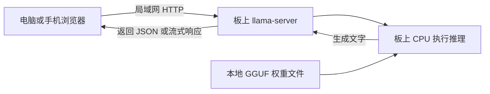

> 历史记录：本页保留前期方案及当时的验证结论。当前版本和执行路线见[学习入口](../README.md)。文中本机路径属于旧工作区。

# LubanCat-1N 本地文字聊天实验方案

状态：已完成选型调查；尚未连接开发板，尚未进行板上构建、推理或性能测试。本文件确定后续实验目标，具体安装命令将在核对板上环境后给出。

## 起步选型

| 部分 | 初始方案 | 要验证的内容 |
| --- | --- | --- |
| 硬件 | LubanCat-1N，RK3566，暂按 2GB 内存 | 实际内存、空闲内存、存储、散热 |
| 新装系统候选 | 野火官方 RK3566 Debian 12 Lite | 1N 支持、网络、存储、重启及软件包可用性 |
| 模型 | Qwen 官方 Qwen2.5-0.5B-Instruct-GGUF，Q4_K_M | 约 491MB 权重文件的版本与 SHA256，能否正确生成中文短回复 |
| 推理引擎 | llama.cpp，ARM64 CPU 构建 | 选择并固定一个通过验证的版本，核对编译器和 C 库 |
| 推理接口 | llama-server 的聊天接口 | 健康检查、请求和响应、超时与忙碌状态 |
| 网页 | 先使用引擎内置网页，再编写静态聊天页 | 一次提问和一次回复，随后加入流式显示 |
| 服务管理 | systemd | 普通用户运行、自动启动、日志、异常恢复 |

这套方案的选择依据是减少初次实验涉及的组件，并为 2GB 环境留出资源。运行速度与稳定性要以实测为准；小模型的回答质量也需要用实际问题评估。

## 请求如何经过 Linux

服务进程通过 Linux 的文件接口读取模型，通过内存管理分配缓存，通过网络接口接收请求。systemd 负责启动和管理服务。Linux 内核提供这些基础能力，模型权重、推理引擎和网页则属于应用部分。

开始时先通过本机监听地址与 SSH 转发验证，随后再安排局域网监听和访问控制。

## 2GB 环境的初始实验范围

- 一个常驻模型，单路生成请求。
- 上下文先从 512 tokens 开始，包含提示词、历史消息和输出所占空间。
- 每次最多生成 64～128 tokens；tokens 是模型处理的单位，与中文字数不一一对应。
- CPU 线程数以 2 和 4 做对照，记录速度与温度。
- 明确记录模型权重、KV 缓存和计算缓冲区的占用，结合系统可用内存判断余量。

这些是试验参数，不是已经测得的最佳配置。权重文件能放进内存，不等于整个服务就能稳定运行；交换空间也不能替代足够的物理内存。

RK3566 带有 NPU，但当前 Rockchip 官方 RKLLM 支持平台列表没有 RK3566，因此第一版选择 CPU 推理。后续若学习图像模型，可单独评估支持 RK3566 的 RKNN 路线。

## 分阶段验收

| 实验 | 操作与观察 | 通过条件 |
| --- | --- | --- |
| 系统基线 | 执行环境检查，确认可用内存、系统和登录 | 能解释开发机与板上信息的区别，板上登录稳定 |
| 模型推理 | 在板上生成一句简短中文回复，观察进程和日志 | 回复可读，记录首次响应时间、生成速度、内存与温度 |
| HTTP 接口 | 请求健康检查和聊天接口 | 返回符合接口格式的数据，能解释模型加载中与请求失败 |
| 网页 | 浏览器提问并显示模型回复 | 请求实际由板上模型处理，网页给出等待与错误状态 |
| 稳定性 | 连续完成 10 次短请求，查看内存及系统日志 | 请求完成，无 OOM；保存参数与日志作为基线 |
| 服务化 | 配置服务，重启开发板后访问 | 服务恢复，日志可查，普通用户运行 |

## 可复现记录

真正部署时，记录系统镜像名与校验值、板上内核版本、推理引擎提交号、工具链版本、模型下载来源与 SHA256、完整运行参数和测量结果。后续升级在此基线上进行对照。

当前代码是 4.19.232；官方 Debian 12 候选镜像使用 6.1.99-7。用户态模型服务需要适配目标系统的 ARM64 指令集及动态库；内核模块则需要匹配实际运行内核的构建环境，这两类兼容性要分别核对。

## 一手资料

- [野火：LubanCat-1 系列硬件介绍](https://doc.embedfire.com/linux/rk356x/quick_start/zh/latest/quick_start/lubancat/lubancat1.html)
- [野火：RK3566/RK3568 的 Debian 12 与 6.1 镜像说明](https://doc.embedfire.com/linux/rk356x/quick_start/zh/latest/quick_start/baidu_cloud/update_history_rk356x_kernel6.1.html)
- [Qwen 官方模型仓库](https://huggingface.co/Qwen/Qwen2.5-0.5B-Instruct-GGUF)
- [Qwen 官方 Q4_K_M 权重文件信息](https://huggingface.co/Qwen/Qwen2.5-0.5B-Instruct-GGUF/blob/main/qwen2.5-0.5b-instruct-q4_k_m.gguf)
- [llama.cpp 构建文档](https://github.com/ggml-org/llama.cpp/blob/master/docs/build.md)
- [llama-server 接口和网页文档](https://github.com/ggml-org/llama.cpp/blob/master/tools/server/README.md)
- [Rockchip 官方 RKLLM 支持平台](https://github.com/airockchip/rknn-llm)
- [Rockchip 官方 RKNN Model Zoo](https://github.com/airockchip/rknn_model_zoo)
